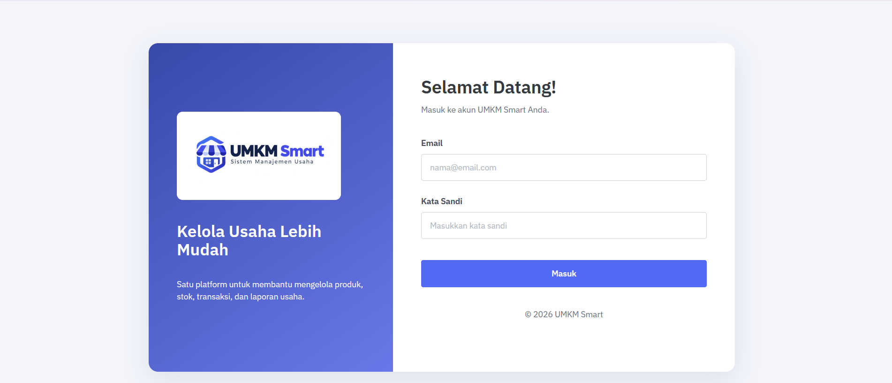
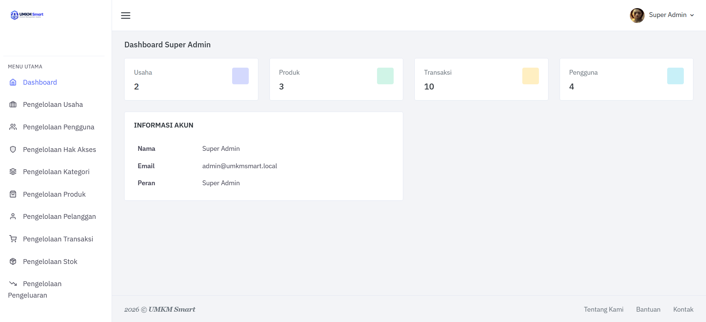
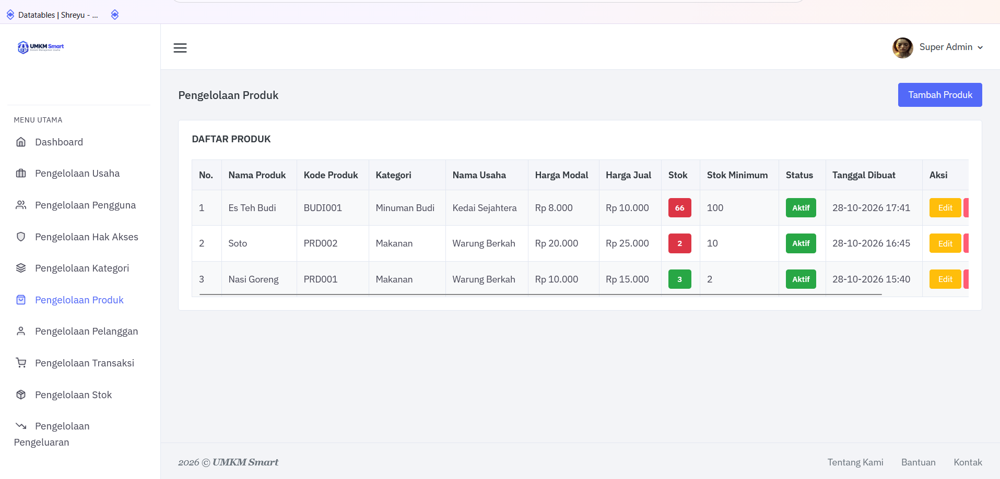
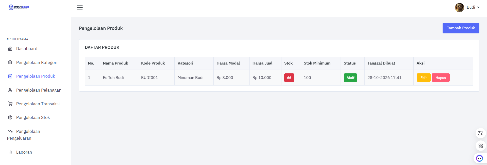
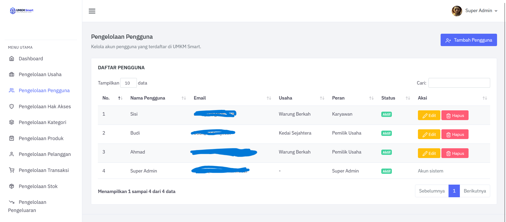
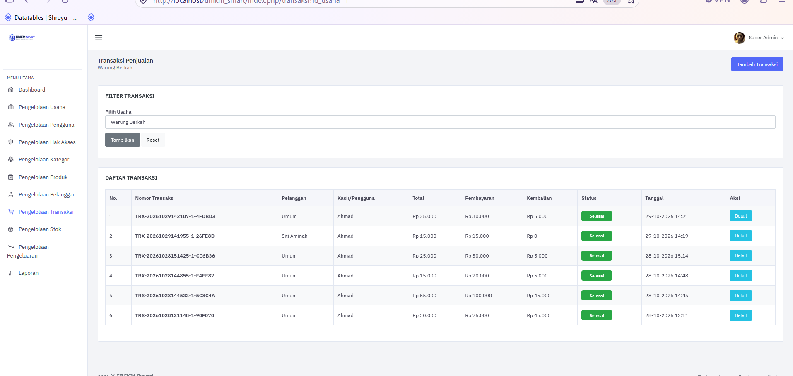

# 🏪 UMKM Smart: Sistem Manajemen Usaha Multi-Tenant

## 📌 Deskripsi Sistem
UMKM Smart adalah aplikasi web multi-tenant untuk membantu usaha mikro mengelola
produk, stok, transaksi, pelanggan, pengeluaran, dan laporan. Satu aplikasi
digunakan oleh banyak usaha, dan data yang ditampilkan kepada pemilik usaha
dibatasi sesuai usaha milik akun yang sedang login.

Hak akses pengguna diatur berbasis peran (Role-Based Access Control) dan disimpan
di database, sehingga dapat diubah tanpa mengubah kode program.

Proyek ini merupakan pengembangan lanjutan dari konsep RBAC pada skripsi penulis,
dari satu sekolah menjadi banyak usaha.

> 🚧 **Status:** MVP, tahap pengujian. Seluruh data pada screenshot adalah data
> contoh (dummy) untuk keperluan demonstrasi.

## 🎯 Fitur Utama
- Autentikasi pengguna (login/logout)
- Dashboard ringkasan
- Pengelolaan usaha, pengguna, dan hak akses (Super Admin)
- Pengelolaan kategori dan produk (harga modal, harga jual, stok minimum)
- Indikator stok menipis
- Pengelolaan pelanggan
- Pengelolaan transaksi penjualan (nomor transaksi, pembayaran, kembalian, status)
- Pengelolaan stok dan riwayat perubahan stok
- Pencatatan pengeluaran usaha
- Laporan dan estimasi keuntungan bersih

## 👥 Peran Pengguna
| Peran | Keterangan |
|-------|------------|

| Super Admin | Mengelola seluruh usaha, pengguna, dan hak akses |
| Pemilik Usaha | Mengelola data operasional usahanya sendiri |
| Karyawan | Menjalankan fungsi operasional sesuai hak akses yang diberikan |

## 🔑 Menu yang Tersedia per Peran
| Menu | Super Admin | Pemilik Usaha | Karyawan |
|------|:-----------:|:-------------:|:--------:|
| Dashboard | ✓ | ✓ | ✓ |
| Pengelolaan Usaha | ✓ | - | - |
| Pengelolaan Pengguna | ✓ | - | - |
| Pengelolaan Hak Akses | ✓ | - | - |
| Kategori, Produk, Pelanggan | ✓ | ✓ | Sesuai izin |
| Transaksi, Stok | ✓ | ✓ | Sesuai izin |
| Pengeluaran, Laporan | ✓ | ✓ | Sesuai izin |

Super Admin dapat melihat data semua usaha, sedangkan Pemilik Usaha hanya melihat
data usahanya sendiri. Hak akses Karyawan ditentukan oleh Super Admin.

## 🛡️ Keamanan
- **Pemisahan data antar-usaha**: data produk, transaksi, dan lainnya difilter
  berdasarkan usaha milik akun yang login
- **RBAC**: menu dan fitur dibatasi berdasarkan peran dan hak akses
- telah diuji: akun satu usaha tidak dapat mengakses atau mengubah data usaha lain.

## 💰 Perhitungan Laporan Keuntungan
`Keuntungan bersih = Total penjualan − Total modal produk − Total pengeluaran usaha`

## 🗄️ Struktur Database
Database `umkm_smart` terdiri dari 12 tabel:

| No | Tabel | Fungsi |
|----|-------|--------|

| 1 | `usaha` | Data usaha (tenant) |
| 2 | `peran` | Jenis peran pengguna |
| 3 | `hak_akses` | Daftar hak akses |
| 4 | `peran_hak_akses` | Relasi peran dengan hak akses |
| 5 | `pengguna` | Akun pengguna |
| 6 | `kategori_produk` | Kategori produk |
| 7 | `produk` | Data produk dan stok |
| 8 | `pelanggan` | Data pelanggan |
| 9 | `transaksi` | Transaksi penjualan |
| 10 | `detail_transaksi` | Rincian produk dalam transaksi |
| 11 | `pengeluaran` | Pengeluaran usaha |
| 12 | `riwayat_stok` | Riwayat perubahan stok |

## 🛠️ Tech Stack
- **Backend**: PHP, CodeIgniter 3
- **Frontend**: HTML, CSS, JavaScript, Bootstrap
- **Database**: MySQL
- **Server**: XAMPP (localhost)

## 📸 Screenshot Sistem
### Halaman Login

### Dashboard Super Admin

### Pengelolaan Produk: Super Admin (semua usaha)

### Pengelolaan Produk: Pemilik Usaha (hanya usaha sendiri)

### Pengelolaan Pengguna

### Transaksi Penjualan

### Dashboard Karyawan

## 📂 Source Code
Source code tersedia atas permintaan. Silakan hubungi sriramadani596@gmail.com.

## 👤 Developer
**Sri Ramadhani**
S1 Informatika, Universitas Almuslim (2026)
IPK: 3,90 | Cumlaude | Wisudawan Terbaik 2026
📧 sriramadani596@gmail.com
